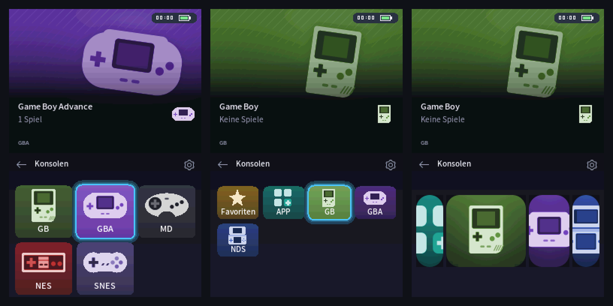

# DsRunner

Ein moderner Launcher für den **Nintendo DS** (getestet auf dem DS Lite mit der Flashkarte **M3 DS Real**). DsRunner startet beim Einschalten automatisch und zeigt deine Spiele in einem dunklen Kachel-Design: erst die Konsolen, dann ihre Spiele, mit großen Bildern auf dem oberen Bildschirm. Gestartet werden die Spiele über [Pico Loader](https://github.com/LNH-team/pico-loader).



<sub>Screenshots aus dem Emulator.</sub>

## Funktionen

- **Startet automatisch** beim Einschalten, ohne Umweg über ein anderes Menü (M3 DS Real)
- **Konsolen und Spiele:** erst NDS, GBA, NES & Co. als Kacheln mit eigenem Bild, dann die Spiele der Konsole
- **Drei Ansichten:** große Kacheln (3×2), kleine Kacheln (4×3) und Coverflow
- **Bilder für jedes Spiel** auf dem oberen Bildschirm und in den Kacheln, automatisch geladen mit dem PC-Programm [DsRunner Art](#bilder-für-die-spiele)
- **Andere Konsolen:** GBA, NES, Game Boy und SNES laufen sofort, die Emulatoren sind im Paket. Master System, Game Gear, Mega Drive und PC Engine mit einem zusätzlichen Download
- **Favoriten** (Taste X), **zuletzt gespielt** als Sortierung und **Weiterspielen** mit START
- **Zurück zu DsRunner aus dem Spiel**, ohne den DS auszuschalten
- Cheats über `usrcheat.dat`, Uhr und Akkuanzeige, Oberfläche auf Deutsch
- **Experimentell:** Browser-Spiele über einen Raspberry Pi auf dem DS spielen ([DsRunner Stream](#dsrunner-stream-experimentell))

## Download

**[⬇ Neueste Version herunterladen](https://github.com/HolziDape/DsRunner/releases/latest)**

| Datei | Wofür |
|---|---|
| **`DsRunner_M3DSReal.zip`** | **M3 DS Real:** komplettes Paket für die SD-Karte, mit Autostart und Emulatoren |
| `DsRunner.zip` | andere Flashkarten, siehe [unten](#andere-flashkarten) |
| `DsRunnerArt.exe` | PC-Programm für Windows, lädt die Bilder für deine Spiele auf die Karte |

Was in welcher Version neu ist, steht im **[Changelog](CHANGELOG.md)**. Die installierte Version siehst du in DsRunner unten rechts im Menü „Anzeige“ (Zahnrad oben rechts).

## Installation (M3 DS Real)

1. **SD-Karte sichern.** Mindestens alle Spielstände (`.sav`), den Ordner `SYSTEM` und die Datei `SRESET.DAT`. Damit kommst du jederzeit zu deinem alten Menü (z. B. YSMenu) zurück.
2. `DsRunner_M3DSReal.zip` entpacken.
3. Den **Inhalt** des entpackten Ordners ins Hauptverzeichnis der SD-Karte kopieren und vorhandene Dateien ersetzen.
4. Deine Spiele in einen Ordner pro Konsole unter `/Games` legen (siehe unten).
5. Karte in den DS stecken und einschalten. DsRunner startet von selbst.

### Ordner für die Spiele

Jeder Unterordner von `/Games` erscheint als eine Konsole:

```
SD-Karte
├── Games
│   ├── NDS     ← DS-Spiele (.nds)
│   ├── GBA     ← Game-Boy-Advance-Spiele (.gba)
│   ├── NES     ← weitere Konsolen, siehe Tabelle unten
│   ├── GB
│   ├── SNES
│   └── Apps    ← Homebrew-Programme
├── _dsrunner   ← Emulatoren, Bilder, Favoriten (legt das Paket bzw. DsRunner an)
├── _nds
└── _pico
```

- Die Ordnernamen `NDS`, `GBA`, `GB`, `GBC`, `NES`, `SNES`, `SMS`, `GG`, `MD`, `PCE` und `Apps` erkennt DsRunner und zeigt sie mit passendem Bild und eigener Farbe. Andere Ordner erscheinen als normale Kachel.
- Ohne Ordner `/Games` zeigt DsRunner das Hauptverzeichnis der Karte. Einen anderen Ordner kannst du in den [Einstellungen](#einstellungen) wählen.

## Andere Konsolen (Emulatoren)

DS-Spiele startet DsRunner direkt. Für andere Konsolen braucht es einen Emulator, ein kleines DS-Programm. DsRunner findet ihn von selbst, wenn er in **`/_dsrunner/emulators/`** liegt. Fehlt der Emulator, bleibt der Ordner der Konsole leer („Keine Spiele“).

| Konsole | Ordner | Dateien | Emulator |
|---|---|---|---|
| Game Boy Advance | `GBA` | `.gba` | GBARunner2: **im Paket** |
| NES | `NES` | `.nes`, `.fds` | nesDS: **im Paket** |
| Game Boy / Color | `GB`, `GBC` | `.gb`, `.gbc` | GameYob: **im Paket** |
| Super Nintendo | `SNES` | `.sfc`, `.smc` | SNEmulDS: **im Paket** |
| Master System / Game Gear | `SMS`, `GG` | `.sms`, `.gg` | [S8DS](https://github.com/FluBBaOfWard/S8DS/releases) herunterladen, `S8DS.nds` aus der ZIP-Datei |
| Mega Drive | `MD` | `.gen`, `.md` | `jEnesisDS.nds` aus dem [Virtual-Console-Add-on von TWiLight Menu++](https://github.com/DS-Homebrew/TWiLightMenu/releases) |
| PC Engine | `PCE` | `.pce` | [NitroGrafx](https://github.com/FluBBaOfWard/NitroGrafx/releases) herunterladen, `NitroGrafx.nds` aus der ZIP-Datei |

- Heruntergeladene Emulatoren nach `/_dsrunner/emulators/` kopieren. Die Dateinamen müssen wie in der Tabelle heißen.
- **GBA-BIOS:** GBARunner2 läuft auch ohne, mit dem originalen BIOS laufen aber mehr Spiele. Das BIOS darf nicht mitgeliefert werden. Wer es hat, legt es als `/_gba/bios.bin` auf die Karte.
- Hast du TWiLight Menu++ installiert, findet DsRunner auch dessen Emulatoren unter `/_nds/TWiLightMenu/emulators/`.
- Lädt ein Mega-Drive-Spiel mit der Endung `.md` nicht, die Datei in `.gen` umbenennen.
- Herkunft und Lizenzen der mitgelieferten Emulatoren: [licenses/emulators](licenses/emulators/LIZENZEN.txt). Alle Details und eigene Konsolen: [docs/CONFIG.md](docs/CONFIG.md#emulatoren).

## Bedienung

| Taste | Funktion |
|---|---|
| Steuerkreuz | Auswahl bewegen |
| A | Konsole öffnen / Spiel starten |
| B | zurück zu den Konsolen |
| L / R | eine Seite weiterblättern |
| X | Spiel zu den Favoriten hinzufügen / entfernen |
| Y | Cheats für das ausgewählte Spiel |
| START | auf der Konsolen-Ebene: das zuletzt gespielte Spiel weiterspielen |
| Zahnrad (oben rechts) | Ansicht, Sortierung und Uhr einstellen |

Der Touchscreen funktioniert ebenfalls.

### Zurück zu DsRunner aus einem Spiel

Im laufenden DS-Spiel **L + R + Unten + B zwei Sekunden halten**. Der Bildschirm wird kurz hell, dann startet DsRunner neu.

- **Vorher im Spiel speichern.** Nicht Gespeichertes geht verloren, wie beim Ausschalten. Ein laufender Speichervorgang wird nicht abgebrochen.
- **Nicht jedes Spiel unterstützt das.** Dann läuft das Spiel ganz normal weiter, nur ohne diese Funktion.
- **Andere Tasten**, z. B. wenn L oder R schlecht reagieren: in den [Einstellungen](#einstellungen) `"inGameResetKeys": "SELECT+START+DOWN"` eintragen.
- Funktioniert mit dem Pico Loader aus `DsRunner_M3DSReal.zip`. Technische Details und Fehlersuche: [loader/README.md](loader/README.md).

## Bilder für die Spiele

Die Bilder für den oberen Bildschirm, die Kacheln und den Coverflow lädt das PC-Programm **DsRunner Art** automatisch:

1. SD-Karte in den PC stecken.
2. `DsRunnerArt.exe` aus dem [Download](https://github.com/HolziDape/DsRunner/releases/latest) starten.
3. Laufwerk wählen und **„Bilder aktualisieren“** klicken.

Das Programm erkennt deine Spiele und lädt passende Titelbilder und Cover aus [libretro-thumbnails](https://github.com/libretro-thumbnails). Es läuft unter Windows, mit Python auch unter Linux und macOS. Anleitung und Optionen: **[docs/ART-TOOL.md](docs/ART-TOOL.md)**.

**Eigene Bilder** gehen auch: ein BMP mit 256 × 192 Pixeln und 256 Farben unter `/_dsrunner/art` ablegen, im selben Pfad wie das Spiel, z. B. `/_dsrunner/art/Games/NDS/Mario Kart DS.bmp` für `/Games/NDS/Mario Kart DS.nds`. Dafür reicht Paint („Speichern unter“ → 256-Farben-Bitmap). Eigene Bilder haben immer Vorrang und werden von DsRunner Art nicht überschrieben.

## Einstellungen

Die meisten Einstellungen (Ansicht, Sortierung, Uhr) gibt es im Menü unter dem Zahnrad. Weitere stehen in der Datei `/_pico/settings.json` auf der SD-Karte. Sie lässt sich mit jedem Texteditor bearbeiten:

| Einstellung | Bedeutung |
|---|---|
| `"libraryPath": "/Games"` | Ordner mit den Konsolen-Ordnern |
| `"inGameReset": false` | „Zurück zu DsRunner aus dem Spiel“ abschalten |
| `"inGameResetKeys": "SELECT+START+DOWN"` | andere Tasten dafür: mindestens 3 aus A, B, SELECT, START, UP, DOWN, LEFT, RIGHT, L, R (nicht X/Y) |

Beim Bearbeiten auf die Kommas zwischen den Zeilen achten. Alle Einstellungen: **[docs/CONFIG.md](docs/CONFIG.md)**.

## DsRunner Stream (experimentell)

Mit **DsRunner Stream** spielst du Browser-Spiele auf dem DS. Ein Raspberry Pi (oder PC) öffnet das Spiel und schickt das Bild per WLAN an den DS, die Tasten und der Touchscreen des DS steuern das Spiel.

- Auf dem DS läuft dafür die App `DsRunnerStream.nds` aus `Games/Apps`.
- Der Pi stellt ein eigenes offenes WLAN nur für den DS bereit und hängt selbst per Kabel am Router.
- Etwa 10 bis 20 Bilder pro Sekunde in 256 Farben, kein Ton auf dem DS. Für ruhigere Spiele gut, für schnelle Action eher nicht.

Noch nicht auf echter Hardware getestet. Einrichtung, Tastenbelegung und Sicherheitshinweise: **[stream/README.md](stream/README.md)**.

## Update auf eine neue Version

1. Aus dem neuen `DsRunner_M3DSReal.zip` die Datei `_nds/TWiLightMenu/main.srldr` auf die Karte kopieren und die alte ersetzen.
2. Steht im [Changelog](CHANGELOG.md) bei der Version **„Pico Loader geändert“**, zusätzlich die fünf `.bin`-Dateien aus `_pico` kopieren.
3. Fehlen dir noch die Emulatoren, einmal den Ordner `_dsrunner/emulators` und die Datei `snemul.cfg` kopieren.

Spiele, Spielstände, Einstellungen, Bilder und Favoriten bleiben dabei erhalten.

## Andere Flashkarten

DsRunner läuft überall, wo Pico Loader läuft. Getestet ist bisher nur die M3 DS Real.

1. `DsRunner.zip` entpacken und den Inhalt ins Hauptverzeichnis der SD-Karte kopieren.
2. Bei [Pico Loader](https://github.com/LNH-team/pico-loader/releases) die Dateien für deine Flashkarte herunterladen und `aplist.bin`, `savelist.bin`, `patchlist.bin`, `picoLoader7.bin` und `picoLoader9.bin` nach `/_pico` kopieren.
3. `DsRunner.nds` aus dem Menü deiner Flashkarte starten.

Einen Autostart gibt es nur für die M3 DS Real. Mit dem offiziellen Pico Loader fehlt außerdem „Zurück zu DsRunner aus dem Spiel“.

## Zurück zum alten Menü (M3 DS Real)

Die gesicherten Dateien `SYSTEM/g6dsload.1`, `SYSTEM/g6dsload.eng` und `SRESET.DAT` zurückkopieren, dann `boot.*`, `loader.eng` und den Ordner `_system_` löschen.

## Probleme?

- **Ein Konsolen-Ordner zeigt „Keine Spiele“:** Der Emulator fehlt oder heißt anders, siehe [Andere Konsolen](#andere-konsolen-emulatoren).
- **Ein Spiel reagiert nicht auf „Zurück zu DsRunner“:** In `/_pico/igr-log.txt` steht nach dem Spielstart, warum. Siehe [loader/README.md](loader/README.md).
- **Ein Spiel läuft schlechter als mit einem anderen Menü:** gerne melden, siehe [Kompatibilitätsliste](docs/compat/pico-vs-ysmenu.md).
- Fehler und Wünsche als [Issue](https://github.com/HolziDape/DsRunner/issues).

## Für Entwickler

DsRunner wird mit [BlocksDS](https://blocksds.skylyrac.net/) in Docker gebaut (unter Windows in WSL2):

```sh
git clone --recursive https://github.com/HolziDape/DsRunner.git
cd DsRunner
./build.sh            # → DsRunner.nds
./build.sh package    # → komplettes SD-Paket für die M3 DS Real in sd-package/
```

Details, Test im Emulator, Pico Loader und Releases: [docs/DEVELOPMENT.md](docs/DEVELOPMENT.md), [loader/README.md](loader/README.md), [docs/RELEASE.md](docs/RELEASE.md). Stand und Pläne: [docs/PLAN.md](docs/PLAN.md).

## Danke & Lizenz

DsRunner ist ein Fork von **[Pico Launcher](https://github.com/LNH-team/pico-launcher)** und nutzt **[Pico Loader](https://github.com/LNH-team/pico-loader)**, beide vom [LNH team](https://github.com/LNH-team): [@Gericom](https://github.com/Gericom), [@XLuma](https://github.com/XLuma), [@Dartz150](https://github.com/Dartz150), [@lifehackerhansol](https://github.com/lifehackerhansol). „Zurück zu DsRunner aus dem Spiel“ und der DLDI-Cache im Pico Loader stammen von [@danyocom](https://github.com/danyocom/pico-loader). Die Autostart-Dateien für die M3 DS Real und einige Emulatoren stammen aus [TWiLight Menu++](https://github.com/DS-Homebrew/TWiLightMenu). Icons von [icons8](https://icons8.com/).

Lizenz: Zlib, siehe `LICENSE.txt`. Weitere Lizenzen im Ordner `licenses`, die der mitgelieferten Emulatoren in `licenses/emulators`.
