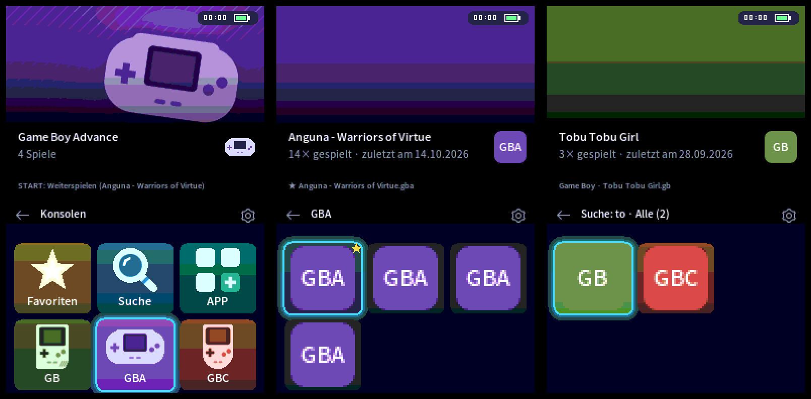
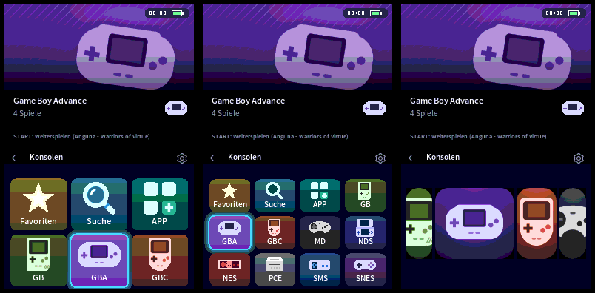
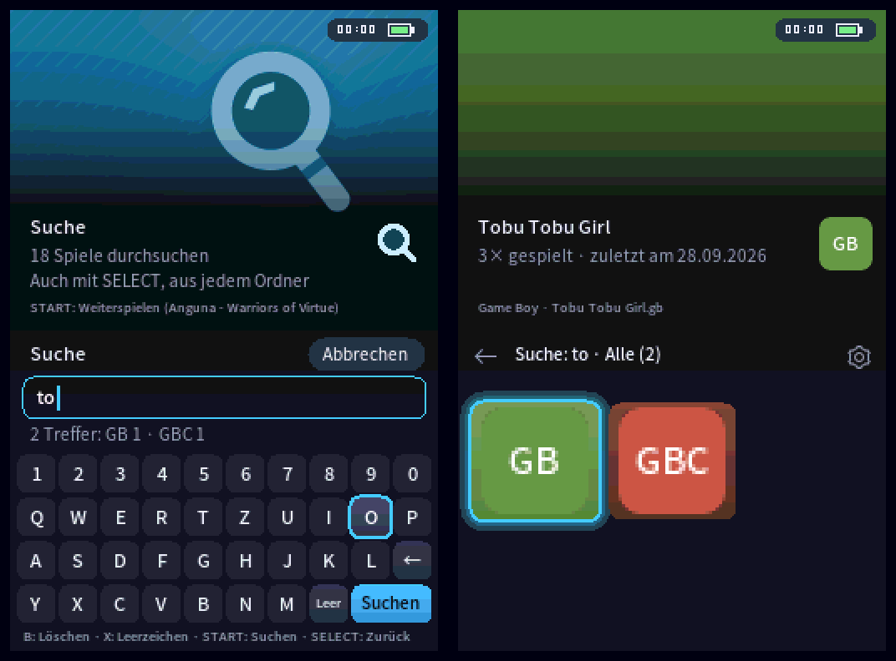
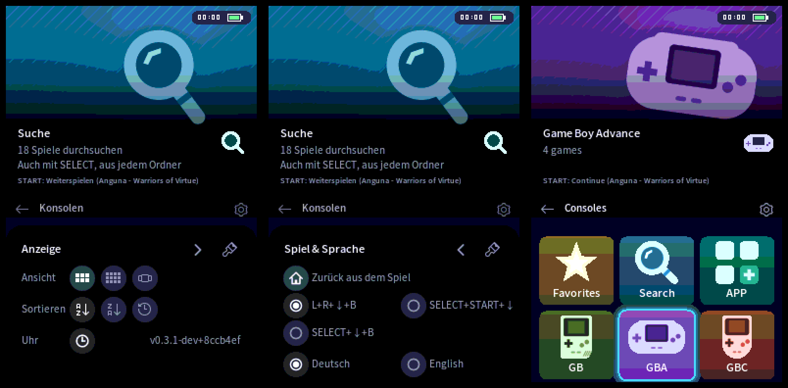
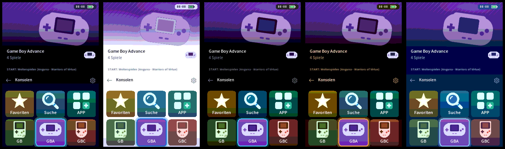

<a id="top"></a>

<h1 align="center">DsRunner</h1>

<p align="center">
  <b>Ein moderner Launcher für den Nintendo DS</b><br>
  Konsolen-Kacheln, große Bilder, Suche, Favoriten, Farb-Themes und „zurück aus dem Spiel“, für die M3 DS Real und viele andere Flashkarten.
</p>

<p align="center">
  <a href="https://github.com/HolziDape/DsRunner/releases/latest"></a>
  
  <a href="LICENSE.txt"></a>
</p>

<p align="center">
  <b>Deutsch</b> · <a href="#english">English</a>
  <br><br>
  <a href="#download">Download</a> ·
  <a href="#installation-m3-ds-real">Installation</a> ·
  <a href="#bedienung">Bedienung</a> ·
  <a href="#kompatible-flashkarten">Flashkarten</a> ·
  <a href="#probleme">Probleme?</a> ·
  <a href="CHANGELOG.md">Changelog</a>
</p>

<p align="center">
  
  <br><sub>Screenshots aus dem Emulator, mit Homebrew-Spielen.</sub>
</p>

---

## Inhalt

- [Funktionen](#funktionen)
- [Screenshots](#screenshots)
- [Download](#download)
- [Installation (M3 DS Real)](#installation-m3-ds-real)
  - [Ordner für die Spiele](#ordner-für-die-spiele)
- [Emulatoren für andere Konsolen](#emulatoren-für-andere-konsolen)
- [Bedienung](#bedienung)
  - [Zurück zu DsRunner aus einem Spiel](#zurück-zu-dsrunner-aus-einem-spiel)
- [Suche](#suche)
- [Menü und Sprache](#menü-und-sprache)
- [Farb-Themes und Musik](#farb-themes-und-musik)
- [Bilder für die Spiele](#bilder-für-die-spiele)
- [Einstellungen](#einstellungen)
- [DsRunner Stream](#dsrunner-stream)
- [Update auf eine neue Version](#update-auf-eine-neue-version)
- [Kompatible Flashkarten](#kompatible-flashkarten)
  - [Installation auf anderen Karten](#installation-auf-anderen-karten)
- [Zurück zum alten Menü (M3 DS Real)](#zurück-zum-alten-menü-m3-ds-real)
- [Probleme?](#probleme)
- [Für Entwickler](#für-entwickler)
- [Danke und Lizenz](#danke-und-lizenz)
- [**English**](#english)

## Funktionen

| | |
|---|---|
|  **Startet automatisch** | beim Einschalten, ohne Umweg über ein anderes Menü (fertig für die M3 DS Real, für viele andere Karten [von Hand](docs/FLASHCARDS.md#autostart)) |
|  **Konsolen und Spiele** | erst NDS, GBA, NES & Co. als Kacheln mit gezeichneter Konsole, dann die Spiele der Konsole |
|  **Drei Ansichten** | große Kacheln (3×2), kleine Kacheln (4×3) und Coverflow |
|  **Andere Konsolen** | GBA, NES, Game Boy / Color und SNES laufen sofort, die Emulatoren sind im Paket. Master System, Game Gear, Mega Drive und PC Engine mit einem zusätzlichen Download |
|  **Suche** | über alle Spiele mit Bildschirmtastatur, Treffer nach Konsole geordnet |
|  **Favoriten und Verlauf** | Favoriten mit X, Sortierung „zuletzt gespielt“, **Weiterspielen** mit START |
|  **Spielstatistik** | wie oft und wann zuletzt gespielt, z. B. „12× gespielt · zuletzt gestern“ |
|  **Saubere Namen** | „Golden Sun“ statt „Golden Sun (Europe) (En,Fr,De).gba“ |
|  **Zurück aus dem Spiel** | Tastenkombination im Spiel startet DsRunner neu, ohne den DS auszuschalten |
|  **Fünf Farb-Themes** | Dark, Hell, OLED, Retro und Blau, dazu eigene Farben per `theme.json` |
|  **Hintergrundmusik** | optional, eigene Lieder per Konverter-Skript |
|  **Deutsch und Englisch** | im Menü umschaltbar, wirkt sofort |
|  **DsRunner Art** | PC-Programm, lädt Bilder und Cover für alle Spiele automatisch |
|  **DsRunner Stream** | Browser-Spiele vom Raspberry Pi per WLAN auf dem DS spielen (experimentell) |

Dazu Cheats über `usrcheat.dat`, Uhr, Akkuanzeige und Touchscreen-Bedienung.

## Screenshots

**Drei Ansichten:** 3×2, 4×3 und Coverflow (Zahnrad → Ansicht)



**Suche:** Tastatur mit Trefferzahl pro Konsole, Ergebnisse wie ein Ordner



**Menü:** Seite „Anzeige“, Seite „Spiel & Sprache“ und die Oberfläche auf Englisch



**Farb-Themes:** Dark, Hell, OLED, Retro und Blau



<p align="right"><sub><a href="#top">↑ nach oben</a></sub></p>

## Download

**[⬇ Neueste Version herunterladen](https://github.com/HolziDape/DsRunner/releases/latest)**

| Datei | Wofür |
|---|---|
| **`DsRunner_M3DSReal.zip`** | **M3 DS Real:** komplettes Paket für die SD-Karte, mit Autostart, Emulatoren und DsRunner Stream |
| `DsRunner.zip` | andere Flashkarten, siehe [Kompatible Flashkarten](#kompatible-flashkarten) |
| `PicoLoader-DsRunner_<Plattform>.zip` | andere Flashkarten: Pico Loader mit „zurück zu DsRunner aus dem Spiel“, eine Datei pro Kartentyp |
| `DsRunnerArt.exe` | PC-Programm für Windows, lädt die Bilder für deine Spiele auf die Karte |
| `DsRunnerStream-Host.zip` | Raspberry-Pi-Teil von [DsRunner Stream](#dsrunner-stream) (ab Version 0.4.0) |

Was in welcher Version neu ist, steht im **[Changelog](CHANGELOG.md)**. Die installierte Version steht in DsRunner unten rechts im Menü (Zahnrad oben rechts).

## Installation (M3 DS Real)

1. **SD-Karte sichern.** Mindestens alle Spielstände (`.sav`), den Ordner `SYSTEM` und die Datei `SRESET.DAT`. Damit kommst du jederzeit zu deinem alten Menü (z. B. YSMenu) zurück.
2. `DsRunner_M3DSReal.zip` entpacken.
3. Den **Inhalt** des entpackten Ordners ins Hauptverzeichnis der SD-Karte kopieren und vorhandene Dateien ersetzen.
4. Deine Spiele in einen Ordner pro Konsole unter `/Games` legen (siehe unten).
5. Karte in den DS stecken und einschalten. DsRunner startet von selbst.

### Ordner für die Spiele

Jeder Unterordner von `/Games` erscheint als eine Konsole:

```
SD-Karte
├── Games
│   ├── NDS     ← DS-Spiele (.nds)
│   ├── GBA     ← Game-Boy-Advance-Spiele (.gba)
│   ├── NES     ← weitere Konsolen, siehe Tabelle unten
│   ├── GB
│   ├── SNES
│   └── Apps    ← Homebrew-Programme (hier liegt auch DsRunnerStream.nds)
├── _dsrunner   ← Emulatoren, Bilder, Favoriten, Statistik (legt das Paket bzw. DsRunner an)
├── _nds
└── _pico       ← Einstellungen, Themes, Pico Loader
```

- Die Ordnernamen `NDS`, `GBA`, `GB`, `GBC`, `NES`, `SNES`, `SMS`, `GG`, `MD`, `PCE` und `Apps` erkennt DsRunner und zeigt sie mit passender Konsole und eigener Farbe. Andere Ordner erscheinen als normale Kachel.
- Ohne Ordner `/Games` zeigt DsRunner das Hauptverzeichnis der Karte. Einen anderen Ordner kannst du in den [Einstellungen](#einstellungen) wählen.

## Emulatoren für andere Konsolen

DS-Spiele startet DsRunner direkt. Für andere Konsolen braucht es einen Emulator, ein kleines DS-Programm. DsRunner findet ihn von selbst, wenn er in **`/_dsrunner/emulators/`** liegt. Fehlt der Emulator, bleibt der Ordner der Konsole leer („Keine Spiele“).

| Konsole | Ordner | Dateien | Emulator |
|---|---|---|---|
| Game Boy Advance | `GBA` | `.gba` | GBARunner2: **im Paket** |
| NES | `NES` | `.nes`, `.fds` | nesDS: **im Paket** |
| Game Boy / Color | `GB`, `GBC` | `.gb`, `.gbc` | GameYob: **im Paket** |
| Super Nintendo | `SNES` | `.sfc`, `.smc` | SNEmulDS: **im Paket** |
| Master System / Game Gear | `SMS`, `GG` | `.sms`, `.gg` | [S8DS](https://github.com/FluBBaOfWard/S8DS/releases) herunterladen, `S8DS.nds` aus der ZIP-Datei |
| Mega Drive | `MD` | `.gen`, `.md` | `jEnesisDS.nds` aus dem [Virtual-Console-Add-on von TWiLight Menu++](https://github.com/DS-Homebrew/TWiLightMenu/releases) |
| PC Engine | `PCE` | `.pce` | [NitroGrafx](https://github.com/FluBBaOfWard/NitroGrafx/releases) herunterladen, `NitroGrafx.nds` aus der ZIP-Datei |

- Heruntergeladene Emulatoren nach `/_dsrunner/emulators/` kopieren. Die Dateinamen müssen wie in der Tabelle heißen.
- **GBA-BIOS:** GBARunner2 läuft auch ohne, mit dem originalen BIOS laufen aber mehr Spiele. Das BIOS darf nicht mitgeliefert werden. Wer es hat, legt es als `/_gba/bios.bin` auf die Karte.
- Hast du TWiLight Menu++ installiert, findet DsRunner auch dessen Emulatoren unter `/_nds/TWiLightMenu/emulators/`.
- Lädt ein Mega-Drive-Spiel mit der Endung `.md` nicht, die Datei in `.gen` umbenennen.
- Herkunft und Lizenzen der mitgelieferten Emulatoren: [licenses/emulators](licenses/emulators/LIZENZEN.txt). Alle Details und eigene Konsolen: [docs/CONFIG.md](docs/CONFIG.md#emulatoren).

<p align="right"><sub><a href="#top">↑ nach oben</a></sub></p>

## Bedienung

| Taste | Funktion |
|---|---|
| Steuerkreuz | Auswahl bewegen |
| A | Konsole öffnen / Spiel starten |
| B | zurück zu den Konsolen |
| L / R | eine Seite weiterblättern; in den Suchergebnissen nur eine Konsole / alle zeigen; im Menü die Seite wechseln |
| X | Spiel zu den Favoriten hinzufügen / entfernen |
| Y | Cheats für das ausgewählte Spiel |
| START | auf der Konsolen-Ebene: das zuletzt gespielte Spiel weiterspielen |
| SELECT | Suche öffnen (auch über die Kachel „Suche“) |
| Zahnrad (oben rechts) | Menü: Ansicht, Sortierung, Uhr, zurück aus dem Spiel, Sprache; der Pinsel darin öffnet die Theme-Auswahl |

Der Touchscreen funktioniert überall ebenfalls.

Oben steht zu jedem Spiel der Name ohne Dateiendung und Zusätze wie „(Europe)“ oder „[!]“, darunter die **Spielstatistik**: wie oft du es gestartet hast und wann zuletzt. DsRunner zählt die Starts in `/_dsrunner/stats.txt`; die Datumsangaben kommen von der Uhr des DS.

### Zurück zu DsRunner aus einem Spiel

Im laufenden DS-Spiel **L + R + Unten + B zwei Sekunden halten**. Der Bildschirm wird kurz hell, dann startet DsRunner neu.

- **Vorher im Spiel speichern.** Nicht Gespeichertes geht verloren, wie beim Ausschalten. Ein laufender Speichervorgang wird nicht abgebrochen.
- **Nicht jedes Spiel unterstützt das.** Dann läuft das Spiel ganz normal weiter, nur ohne diese Funktion.
- **Andere Tasten**, z. B. wenn L oder R schlecht reagieren: im Menü auf der Seite „Spiel & Sprache“ SELECT+START+↓ oder SELECT+↓+B wählen. Eigene Kombinationen gehen über `"inGameResetKeys"` in den [Einstellungen](#einstellungen).
- Funktioniert mit dem Pico Loader aus `DsRunner_M3DSReal.zip` bzw. `PicoLoader-DsRunner_<Plattform>.zip`, nicht mit dem offiziellen Pico Loader. Technische Details und Fehlersuche: [loader/README.md](loader/README.md).

## Suche

SELECT in jedem Ordner oder die Kachel **Suche** auf der Konsolen-Ebene öffnet eine Bildschirmtastatur.

- Tippen mit Touchscreen oder Steuerkreuz + A; B löscht, X macht ein Leerzeichen, START sucht, SELECT geht zurück.
- Schon beim Tippen steht da, wie viele Spiele pro Konsole passen.
- Die Treffer erscheinen wie ein Ordner, nach Konsole geordnet und in der Farbe der Konsole. L / R zeigen nur eine Konsole oder alle.
- Gesucht wird im Dateinamen, ohne Groß-/Kleinschreibung, Akzente und Satzzeichen. Durchsucht werden alle Konsolen, für die ein Emulator da ist.

## Menü und Sprache

Das **Zahnrad** oben rechts öffnet das Menü. Es hat zwei Seiten, **L / R** oder der Pfeil neben dem Pinsel wechseln zwischen ihnen. Änderungen werden beim Schließen gespeichert.

| Seite | Einstellungen |
|---|---|
| **Anzeige** | Ansicht (3×2, 4×3, Coverflow), Sortieren (A–Z, Z–A, zuletzt gespielt), Uhr ein/aus, installierte Version |
| **Spiel & Sprache** | Zurück aus dem Spiel ein/aus, die Tasten dafür, Sprache **Deutsch / English** |

Die Sprache wechselt sofort, ohne Neustart. Auf Englisch hat die Such-Tastatur QWERTY statt QWERTZ.

## Farb-Themes und Musik

**Themes wechseln:** Zahnrad → Pinsel → Theme in der Liste wählen. Dabei sind:

| Theme | Aussehen |
|---|---|
| DsRunner Dark | dunkles Blaugrau mit Cyan-Akzent (Standard) |
| DsRunner Hell | hellgrau mit weißen Kacheln und blauem Akzent |
| DsRunner OLED | reines Schwarz mit Cyan-Akzent |
| DsRunner Retro | warmes Dunkelbraun mit Bernstein-Akzent |
| DsRunner Blau | tiefes Blau mit hellblauem Akzent |

**Eigenes Theme:** einen Ordner in `/_pico/themes` kopieren (z. B. `dsrunner-blau` nach `mein-theme`) und in der `theme.json` den Namen und die Farben unter `"colors"` ändern (`"#RRGGBB"`). Alle Farben: [docs/CONFIG.md](docs/CONFIG.md#farb-themes).

**Hintergrundmusik:** Standardmäßig aus. Eine `.bcstm`-Datei in `/_pico/themes/dsrunner/bgm/` legen, schon spielt DsRunner sie im Menü in Schleife. Zum Ausprobieren liegt eine selbst erzeugte Beispiel-Schleife bei: den Ordner `/_pico/themes/dsrunner/musik-beispiel` in `bgm` umbenennen. Eigene MP3- oder WAV-Dateien wandelt `tools/bgm/wav2bcstm.py` um. `"music": false` schaltet die Musik ab, `"musicVolume"` (0 bis 100) macht sie leiser. Anleitung: [docs/CONFIG.md](docs/CONFIG.md#hintergrundmusik).

<p align="right"><sub><a href="#top">↑ nach oben</a></sub></p>

## Bilder für die Spiele

Die Bilder für den oberen Bildschirm, die Kacheln und den Coverflow lädt das PC-Programm **DsRunner Art** automatisch:

1. SD-Karte in den PC stecken.
2. `DsRunnerArt.exe` aus dem [Download](https://github.com/HolziDape/DsRunner/releases/latest) starten.
3. Laufwerk wählen und **„Bilder aktualisieren“** klicken.

Das Programm erkennt deine Spiele und lädt passende Titelbilder und Cover aus [libretro-thumbnails](https://github.com/libretro-thumbnails). Es läuft unter Windows, mit Python auch unter Linux und macOS. Anleitung und Optionen: **[docs/ART-TOOL.md](docs/ART-TOOL.md)**.

**Eigene Bilder** gehen auch: ein BMP mit 256 × 192 Pixeln und 256 Farben unter `/_dsrunner/art` ablegen, im selben Pfad wie das Spiel, z. B. `/_dsrunner/art/Games/NDS/Mein Spiel.bmp` für `/Games/NDS/Mein Spiel.nds`. Dafür reicht Paint („Speichern unter“ → 256-Farben-Bitmap). Eigene Bilder haben immer Vorrang und werden von DsRunner Art nicht überschrieben.

## Einstellungen

Die meisten Einstellungen gibt es im [Menü](#menü-und-sprache). Alle stehen in der Datei `/_pico/settings.json` auf der SD-Karte, die sich mit jedem Texteditor bearbeiten lässt:

| Einstellung | Bedeutung |
|---|---|
| `"libraryPath": "/Games"` | Ordner mit den Konsolen-Ordnern |
| `"uiLanguage": "en"` | Oberfläche auf Englisch (`"de"` = Deutsch, Standard) |
| `"cleanNames": false` | Spielnamen mit Region und Zusätzen zeigen, nur ohne Dateiendung |
| `"inGameReset": false` | „Zurück zu DsRunner aus dem Spiel“ abschalten |
| `"inGameResetKeys": "SELECT+START+DOWN"` | andere Tasten dafür: mindestens 3 aus A, B, SELECT, START, UP, DOWN, LEFT, RIGHT, L, R (nicht X/Y) |
| `"music": false` / `"musicVolume": 50` | Hintergrundmusik aus / leiser |

Beim Bearbeiten auf die Kommas zwischen den Zeilen achten. Alle Einstellungen: **[docs/CONFIG.md](docs/CONFIG.md)**.

## DsRunner Stream

> **Experimentell.** Mit **DsRunner Stream** spielst du Browser-Spiele auf dem DS. Ein Raspberry Pi 5 (oder PC) öffnet das Spiel und schickt das Bild per WLAN an den DS; die Tasten und der Touchscreen des DS steuern das Spiel.

- Auf dem DS: die App `DsRunnerStream.nds`, im Paket unter `Games/Apps`.
- Auf dem Pi: `DsRunnerStream-Host.zip` entpacken und `tools/install-pi.sh` ausführen. Der Installer richtet Chromium, die Python-Pakete, ein eigenes offenes WLAN für den DS und das Start-Skript `~/dsstream.sh` ein. Der Pi selbst hängt per Kabel am Router.
- Auf DS Lite + Raspberry Pi 5 getestet: etwa **18 bis 25 Bilder pro Sekunde** in 256 Farben, kein Ton auf dem DS. Für ruhigere Spiele gut, für schnelle Action eher nicht.

Einrichtung, Tastenbelegung und Sicherheitshinweise: **[stream/README.md](stream/README.md)**.

## Update auf eine neue Version

1. Aus dem neuen `DsRunner_M3DSReal.zip` die Datei `_nds/TWiLightMenu/main.srldr` auf die Karte kopieren und die alte ersetzen.
2. Den Ordner `_pico/themes` kopieren (neue Themes, Konsolen-Bilder und Musik-Beispiel).
3. Steht im [Changelog](CHANGELOG.md) bei der Version **„Pico Loader geändert“**, zusätzlich die fünf `.bin`-Dateien aus `_pico` kopieren.
4. Fehlen dir noch die Emulatoren oder DsRunner Stream, einmal den Ordner `_dsrunner/emulators`, die Datei `snemul.cfg` und `Games/Apps/DsRunnerStream.nds` kopieren.

Spiele, Spielstände, Einstellungen, Bilder, Favoriten und Statistik bleiben dabei erhalten. Andere Flashkarten: siehe [docs/FLASHCARDS.md](docs/FLASHCARDS.md#autostart).

<p align="right"><sub><a href="#top">↑ nach oben</a></sub></p>

## Kompatible Flashkarten

**DsRunner ist nicht auf die M3 DS Real beschränkt.** Getestet ist bisher allerdings nur die M3 DS Real. Was wo geht:

- **Überall gleich:** das Menü selbst (ein normales DS-Homebrew-Programm), die Emulatoren, DsRunner Art (läuft am PC) und DsRunner Stream (DS, DS Lite, DSi und 3DS im DS-Modus; WLAN nur offen oder WEP).
- **Hängt von der Karte ab:** Spiele startet DsRunner über **Pico Loader**, und den gibt es nur für bestimmte Karten („Plattformen“). Ohne passende Plattform startet DsRunner, aber kein Spiel. Auch der **Autostart** ist je Karte verschieden.
- **Zurück zu DsRunner aus dem Spiel** steckt in unserem Pico Loader und sollte auf allen Plattformen gleich funktionieren, außer `R4` (dort nur in manchen Spielen).

<details open>
<summary><b>Tabelle der Karten</b></summary>

| Karte (bekannte Namen und Klone) | Pico-Loader-Plattform | Spiele starten | Autostart möglich | Zurück aus dem Spiel | Getestet |
|---|---|---|---|---|---|
| **M3 DS Real** | `M3DS` | ja | ja, fertiges Paket | ja | **ja** (DS Lite) |
| M3i Zero (nicht GMP-Z003), iTouchDS, r4rts.com, r4isdhc.com RTS (schwarz) | `M3DS` | ja | ja, Paket der M3 DS Real | ja | sollte funktionieren (ungetestet) |
| M3i Zero (GMP-Z003) | `G003` | ja | ja | ja | sollte funktionieren (ungetestet) |
| Acekard 2, 2.1, 2i, r4ids.cn und Ableger | `AK2` | ja | ja | ja | sollte funktionieren (ungetestet) |
| Acekard RPG | `AKRPG` | ja | nein | ja | sollte funktionieren (ungetestet) |
| Ace3DS+, Gateway 3DS (blau), r4isdhc.com.cn, r4isdhc.hk ab 2020 und Ableger | `ACE3DS` | ja | ja | ja | sollte funktionieren (ungetestet) |
| DSTT, SuperCard DSONE SDHC, r4isdhc.com ab 2014, r4i-sdhc.com und Ableger | `DSTT` | ja | ja | ja | sollte funktionieren (ungetestet) |
| r4idsn.com | `R4iDSN` | ja | ja | ja | sollte funktionieren (ungetestet) |
| Original R4DS (ohne SDHC), M3 DS Simply | `R4` | ja | ja | nur in manchen Spielen | sollte funktionieren (ungetestet) |
| Stargate 3DS | `STARGATE` | ja | ja | ja | sollte funktionieren (ungetestet) |
| DSpico | `DSPICO` | ja | ja | ja | sollte funktionieren (ungetestet) |
| EZ-Flash Parallel | `EZP` | ja | ja | ja | sollte funktionieren (ungetestet) |
| DATEL Games n' Music, Action Replay DS(i) Media Edition | `DATEL` | ja | nur Games n' Music | ja | sollte funktionieren (ungetestet) |
| Slot 2: SuperCard SD/Lite/Rumble, SuperChis · SuperCard CF · M3 CF · Max Media Dock CF · GBA Movie Player CF | `SUPERCARD` · `SUPERCARDCF` · `M3CF` · `MMCF` · `MPCF` | ja | nur GBA Movie Player | ja | sollte funktionieren (ungetestet) |

</details>

Namen und Klone wie im [Pico-Loader-README](https://github.com/LNH-team/pico-loader#supported-platforms). **Wähle nur eine Plattform, unter der deine Karte mit Namen steht:** Die falsche kann laut Pico Loader die Karte beschädigen. Nicht dabei sind z. B. SuperCard DSTWO, EZ-Flash V/Vi und iSmart Premium. Auf DSi und 3DS gilt dasselbe, solange DsRunner von der Flashkarte läuft. Alle Details, Hinweise zu Klonen, DSi/3DS und GBARunner2: **[docs/FLASHCARDS.md](docs/FLASHCARDS.md)**.

### Installation auf anderen Karten

1. SD-Karte sichern (Spielstände und die Menü-Dateien deiner Karte).
2. `DsRunner.zip` entpacken und den Inhalt ins Hauptverzeichnis der SD-Karte kopieren.
3. `PicoLoader-DsRunner_<Plattform>.zip` für deine Karte aus der Tabelle entpacken und den Inhalt ebenfalls ins Hauptverzeichnis kopieren (landet in `/_pico`). Fehlt diese Datei (bei Releases bis 0.3.1), gehen auch die Dateien `aplist.bin`, `savelist.bin`, `patchlist.bin`, `picoLoader7.bin` und `picoLoader9.bin` aus dem [offiziellen Pico Loader](https://github.com/LNH-team/pico-loader/releases), dann aber ohne „zurück aus dem Spiel“.
4. `DsRunner.nds` aus dem Menü deiner Karte starten.

**Autostart:** Für die meisten Karten liefert [TWiLight Menu++](https://github.com/DS-Homebrew/TWiLightMenu/releases) in `TWiLightMenu-Flashcard.7z` (Ordner `Autoboot`) Startdateien, die `/_nds/TWiLightMenu/main.srldr` starten. Die Dateien deiner Karte ins Hauptverzeichnis kopieren und `DsRunner.nds` als `/_nds/TWiLightMenu/main.srldr` ablegen. Bei der DSpico reicht es, `DsRunner.nds` in `/_picoboot.nds` umzubenennen. Ausnahmen und Schritt für Schritt: [docs/FLASHCARDS.md](docs/FLASHCARDS.md#autostart).

## Zurück zum alten Menü (M3 DS Real)

Die gesicherten Dateien `SYSTEM/g6dsload.1`, `SYSTEM/g6dsload.eng` und `SRESET.DAT` zurückkopieren, dann `boot.*`, `loader.eng` und den Ordner `_system_` löschen.

## Probleme?

| Problem | Lösung |
|---|---|
| Ein Konsolen-Ordner zeigt „Keine Spiele“ | Der Emulator fehlt oder heißt anders, siehe [Emulatoren](#emulatoren-für-andere-konsolen). |
| „Failed to load rom header“ beim Start eines Spiels | Die Emulator-Datei ist kaputt oder leer. Neu herunterladen und ersetzen. |
| Ein Spiel reagiert nicht auf „Zurück zu DsRunner“ | In `/_pico/igr-log.txt` steht nach dem Spielstart, warum. Siehe [loader/README.md](loader/README.md). Reagieren L oder R schlecht, andere Tasten im Menü wählen. |
| Falsches oder fehlendes Datum in der Spielstatistik | Die Uhr des DS ist nicht gestellt (DS-Systemeinstellungen). |
| Ein Spiel läuft schlechter als mit einem anderen Menü | Gerne melden, siehe [Kompatibilitätsliste](docs/compat/pico-vs-ysmenu.md). |
| DsRunner Stream verbindet nicht | Siehe [Fehlersuche im Stream-README](stream/README.md). |

Fehler und Wünsche gerne als [Issue](https://github.com/HolziDape/DsRunner/issues).

## Für Entwickler

DsRunner wird mit [BlocksDS](https://blocksds.skylyrac.net/) in Docker gebaut (unter Windows in WSL2):

```sh
git clone --recursive https://github.com/HolziDape/DsRunner.git
cd DsRunner
./build.sh            # → DsRunner.nds
./build.sh package    # → komplettes SD-Paket für die M3 DS Real in sd-package/
```

| Thema | Dokument |
|---|---|
| Bauen, Test im Emulator, SD-Pakete | [docs/DEVELOPMENT.md](docs/DEVELOPMENT.md) |
| Alle Einstellungen, Ordner und Dateiformate | [docs/CONFIG.md](docs/CONFIG.md) |
| Themes (auch Picos eigene) | [docs/Themes.md](docs/Themes.md) |
| Pico Loader und die DsRunner-Patches | [loader/README.md](loader/README.md), [docs/LOADER.md](docs/LOADER.md) |
| Releases und Versionen | [docs/RELEASE.md](docs/RELEASE.md) |
| DsRunner Art | [docs/ART-TOOL.md](docs/ART-TOOL.md) |
| DsRunner Stream und Protokoll | [stream/README.md](stream/README.md), [stream/PROTOCOL.md](stream/PROTOCOL.md) |
| Stand und Pläne | [docs/PLAN.md](docs/PLAN.md) |

## Danke und Lizenz

DsRunner ist ein Fork von **[Pico Launcher](https://github.com/LNH-team/pico-launcher)** und nutzt **[Pico Loader](https://github.com/LNH-team/pico-loader)**, beide vom [LNH team](https://github.com/LNH-team): [@Gericom](https://github.com/Gericom), [@XLuma](https://github.com/XLuma), [@Dartz150](https://github.com/Dartz150), [@lifehackerhansol](https://github.com/lifehackerhansol). „Zurück zu DsRunner aus dem Spiel“ und der DLDI-Cache im Pico Loader stammen von [@danyocom](https://github.com/danyocom/pico-loader). Die Autostart-Dateien für die M3 DS Real und einige Emulatoren stammen aus [TWiLight Menu++](https://github.com/DS-Homebrew/TWiLightMenu). Icons von [icons8](https://icons8.com/).

Lizenz: Zlib, siehe `LICENSE.txt`. Weitere Lizenzen im Ordner `licenses`, die der mitgelieferten Emulatoren in `licenses/emulators`.

<p align="right"><sub><a href="#top">↑ nach oben</a></sub></p>

---

## English

<p align="center"><a href="#top">Deutsch</a> · <b>English</b></p>

**DsRunner is a modern launcher for the Nintendo DS.** It starts automatically when you switch the DS on and shows your games in a tile design: first the consoles, then their games, with big pictures on the top screen. Games are started through [Pico Loader](https://github.com/LNH-team/pico-loader). It is tested on a DS Lite with the **M3 DS Real** flashcard and should run on every flashcard Pico Loader supports.

- [What it does](#what-it-does)
- [Installing (M3 DS Real)](#installing-m3-ds-real)
- [Game folders and emulators](#game-folders-and-emulators)
- [Controls](#controls)
- [Returning from a game](#returning-from-a-game)
- [Search, menu and language](#search-menu-and-language)
- [Themes and music](#themes-and-music)
- [Game artwork](#game-artwork)
- [Settings file](#settings-file)
- [DsRunner Stream (browser games)](#dsrunner-stream-browser-games)
- [Updating](#updating)
- [Other flashcards](#other-flashcards)
- [Troubleshooting](#troubleshooting)
- [Building and credits](#building-and-credits)

### What it does

- **Starts automatically** when the DS is switched on (ready-made for the M3 DS Real; other cards [by hand](docs/FLASHCARDS.md#autostart)).
- **Consoles, then games:** NDS, GBA, NES and others as tiles with a drawn console in its own color.
- **Three views:** big tiles (3×2), small tiles (4×3) and Coverflow.
- **Other consoles:** GBA, NES, Game Boy / Color and SNES work out of the box; the emulators are in the package.
- **Search** across all games with an on-screen keyboard, results grouped by console.
- **Favorites** (X), **last played** sorting and **continue** with START.
- **Play statistics** ("Played 12× · last yesterday") and **clean names** ("Golden Sun" instead of "Golden Sun (Europe) (En,Fr,De).gba").
- **Return from a game** with a key combo, without switching the DS off.
- **Five color themes** plus your own colors, optional **background music**.
- **German and English** UI, switchable in the menu.
- **DsRunner Art**, a PC tool that downloads pictures and covers for your games.
- **DsRunner Stream** (experimental): play browser games streamed from a Raspberry Pi over WiFi.

### Installing (M3 DS Real)

Download from the **[latest release](https://github.com/HolziDape/DsRunner/releases/latest)**:

| File | For |
|---|---|
| **`DsRunner_M3DSReal.zip`** | **M3 DS Real:** complete SD card package with autostart, emulators and DsRunner Stream |
| `DsRunner.zip` | other flashcards, see [Other flashcards](#other-flashcards) |
| `PicoLoader-DsRunner_<platform>.zip` | other flashcards: Pico Loader with "return from game", one file per card type |
| `DsRunnerArt.exe` | Windows tool that puts pictures for your games on the card |
| `DsRunnerStream-Host.zip` | Raspberry Pi side of DsRunner Stream (from version 0.4.0) |

1. **Back up your SD card**, at least all saves (`.sav`), the `SYSTEM` folder and `SRESET.DAT`. With them you can always go back to your old menu (e.g. YSMenu).
2. Unzip `DsRunner_M3DSReal.zip`.
3. Copy the **contents** of the unzipped folder to the root of the SD card and replace existing files.
4. Put your games into one folder per console under `/Games` (see below).
5. Insert the card and switch the DS on. DsRunner starts by itself.

To go back to the old menu: copy the saved `SYSTEM/g6dsload.1`, `SYSTEM/g6dsload.eng` and `SRESET.DAT` back, then delete `boot.*`, `loader.eng` and the `_system_` folder.

### Game folders and emulators

Every subfolder of `/Games` is shown as a console. DsRunner knows the folder names `NDS`, `GBA`, `GB`, `GBC`, `NES`, `SNES`, `SMS`, `GG`, `MD`, `PCE` and `Apps`; other folders appear as plain tiles. Games for other consoles need an emulator in **`/_dsrunner/emulators/`**:

| Console | Folder | Files | Emulator |
|---|---|---|---|
| Game Boy Advance | `GBA` | `.gba` | GBARunner2: **included** |
| NES | `NES` | `.nes`, `.fds` | nesDS: **included** |
| Game Boy / Color | `GB`, `GBC` | `.gb`, `.gbc` | GameYob: **included** |
| Super Nintendo | `SNES` | `.sfc`, `.smc` | SNEmulDS: **included** |
| Master System / Game Gear | `SMS`, `GG` | `.sms`, `.gg` | download [S8DS](https://github.com/FluBBaOfWard/S8DS/releases), use `S8DS.nds` |
| Mega Drive | `MD` | `.gen`, `.md` | `jEnesisDS.nds` from the [TWiLight Menu++ Virtual Console add-on](https://github.com/DS-Homebrew/TWiLightMenu/releases) |
| PC Engine | `PCE` | `.pce` | download [NitroGrafx](https://github.com/FluBBaOfWard/NitroGrafx/releases), use `NitroGrafx.nds` |

The GBA BIOS is optional and not included; if you own it, put it at `/_gba/bios.bin`. Emulators installed with TWiLight Menu++ are found too.

### Controls

| Key | Action |
|---|---|
| D-pad | move the selection |
| A | open console / start game |
| B | back to the consoles |
| L / R | next page; in search results one console / all; in the menu switch page |
| X | add / remove favorite |
| Y | cheats for the selected game |
| START | on the console level: continue the last played game |
| SELECT | open the search |
| Gear (top right) | menu: view, sorting, clock, return from game, language; the brush opens the theme list |

The touchscreen works everywhere too.

### Returning from a game

In a running DS game **hold L + R + Down + B for two seconds**. The screen flashes bright, then DsRunner starts again.

- **Save first.** Unsaved progress is lost, like switching off. A running save is not interrupted.
- **Not every game supports it.** Then the game simply keeps running without this feature.
- **Other keys**, e.g. with worn L/R buttons: choose SELECT+START+↓ or SELECT+↓+B on the second menu page, or set any combo with `"inGameResetKeys"`.
- Works with the Pico Loader from `DsRunner_M3DSReal.zip` or `PicoLoader-DsRunner_<platform>.zip`, not with the official Pico Loader. Details: [loader/README.md](loader/README.md).

### Search, menu and language

- **Search:** SELECT or the **Search** tile opens a keyboard (touch or D-pad + A; B deletes, X space, START searches). The match count per console updates while typing; results show up like a folder, grouped by console.
- **Menu:** the gear opens two pages, switched with L / R. Page **Display**: view, sorting, clock, version. Page **Game & language**: return from game on/off, its keys, **Deutsch / English**.
- **Language:** switches instantly. The default is German; choose **English** in the menu or set `"uiLanguage": "en"`. The English keyboard is QWERTY.

### Themes and music

- **Themes:** gear → brush → pick DsRunner Dark, Light ("Hell"), OLED, Retro or Blue ("Blau"). For your own theme copy a folder in `/_pico/themes` and change the colors under `"colors"` in its `theme.json` ([all keys](docs/Themes.md#dsrunner-type)).
- **Music:** off by default. Put a `.bcstm` file (DSP-ADPCM) into `/_pico/themes/dsrunner/bgm/`, or rename the included example folder `musik-beispiel` to `bgm`. `tools/bgm/wav2bcstm.py` converts MP3/WAV files. `"music": false` turns it off, `"musicVolume"` (0–100) makes it quieter.

### Game artwork

Run **`DsRunnerArt.exe`** on your PC with the SD card inserted, choose the drive and click **"Bilder aktualisieren"** (update pictures). It recognizes your games and downloads title screens and covers from [libretro-thumbnails](https://github.com/libretro-thumbnails); it also runs on Linux and macOS with Python ([docs/ART-TOOL.md](docs/ART-TOOL.md)). Your own pictures work too: a 256 × 192 BMP with 256 colors in `/_dsrunner/art`, mirroring the game's path.

### Settings file

Most settings are in the menu. All of them live in `/_pico/settings.json`:

| Setting | Meaning |
|---|---|
| `"libraryPath": "/Games"` | folder with the console folders |
| `"uiLanguage": "en"` | English UI (`"de"` = German, default) |
| `"cleanNames": false` | show names with region tags, only without the extension |
| `"inGameReset": false` | turn off "return from game" |
| `"inGameResetKeys": "SELECT+START+DOWN"` | other keys: at least 3 of A, B, SELECT, START, UP, DOWN, LEFT, RIGHT, L, R |
| `"music": false` / `"musicVolume": 50` | background music off / quieter |

Mind the commas between lines. Full reference (German): [docs/CONFIG.md](docs/CONFIG.md).

### DsRunner Stream (browser games)

> **Experimental.** A Raspberry Pi 5 (or PC) opens a browser game and streams the picture over WiFi to the DS; the DS keys and touchscreen control the game.

On the DS run `Games/Apps/DsRunnerStream.nds`. On the Pi unzip `DsRunnerStream-Host.zip` and run `tools/install-pi.sh`, which sets up Chromium, the Python packages, an open WiFi network just for the DS and the start script `~/dsstream.sh`. Tested on DS Lite + Raspberry Pi 5: about **18–25 frames per second** in 256 colors, no sound on the DS. Setup and troubleshooting (German): [stream/README.md](stream/README.md).

### Updating

1. Copy `_nds/TWiLightMenu/main.srldr` from the new `DsRunner_M3DSReal.zip` to the card.
2. Copy the `_pico/themes` folder.
3. If the [changelog](CHANGELOG.md) says **"Pico Loader geändert"** (Pico Loader changed) for the version, also copy the five `.bin` files in `_pico`.
4. If you don't have them yet, copy `_dsrunner/emulators`, `snemul.cfg` and `Games/Apps/DsRunnerStream.nds` once.

Games, saves, settings, pictures, favorites and statistics stay.

### Other flashcards

DsRunner itself is a normal DS homebrew program. Starting games needs **Pico Loader**, which supports these card families ("platforms"): `M3DS` (M3 DS Real, M3i Zero, iTouchDS), `G003`, `AK2` (Acekard 2/2i), `AKRPG`, `ACE3DS` (Ace3DS+, Gateway blue), `DSTT`, `R4iDSN`, `R4` (original R4DS), `STARGATE`, `DSPICO`, `EZP` (EZ-Flash Parallel), `DATEL` and the slot-2 cards `SUPERCARD`, `SUPERCARDCF`, `M3CF`, `MMCF`, `MPCF`. Only the M3 DS Real is tested so far.

1. Back up your card, unzip `DsRunner.zip` to the root of the SD card.
2. Unzip `PicoLoader-DsRunner_<platform>.zip` for **your** card to the root as well. **Only choose a platform that lists your card by name**; a wrong one can damage the card according to Pico Loader.
3. Start `DsRunner.nds` from your card's menu. For autostart see [docs/FLASHCARDS.md](docs/FLASHCARDS.md#autostart) (TWiLight Menu++ autoboot files; on the DSpico rename it to `/_picoboot.nds`).

The full table with clone names is [above](#kompatible-flashkarten).

### Troubleshooting

| Problem | Fix |
|---|---|
| A console folder shows "No games" | The emulator is missing or has another name, see [emulators](#game-folders-and-emulators). |
| "Failed to load rom header" when starting a game | The emulator file is broken or empty; download it again. |
| A game ignores "return from game" | `/_pico/igr-log.txt` says why after the game started ([loader/README.md](loader/README.md)). |
| Wrong date in the play statistics | Set the clock in the DS system settings. |

Bugs and wishes: [issues](https://github.com/HolziDape/DsRunner/issues).

### Building and credits

Build with `git clone --recursive https://github.com/HolziDape/DsRunner.git`, then `./build.sh` (Docker with [BlocksDS](https://blocksds.skylyrac.net/)); see [docs/DEVELOPMENT.md](docs/DEVELOPMENT.md).

DsRunner is a fork of **[Pico Launcher](https://github.com/LNH-team/pico-launcher)** and uses **[Pico Loader](https://github.com/LNH-team/pico-loader)**, both by the [LNH team](https://github.com/LNH-team). "Return from game" and the DLDI cache in Pico Loader are by [@danyocom](https://github.com/danyocom/pico-loader). Autostart files and some emulators come from [TWiLight Menu++](https://github.com/DS-Homebrew/TWiLightMenu). Icons by [icons8](https://icons8.com/). License: Zlib (`LICENSE.txt`), more in `licenses`.

<p align="right"><sub><a href="#top">↑ back to top</a></sub></p>
